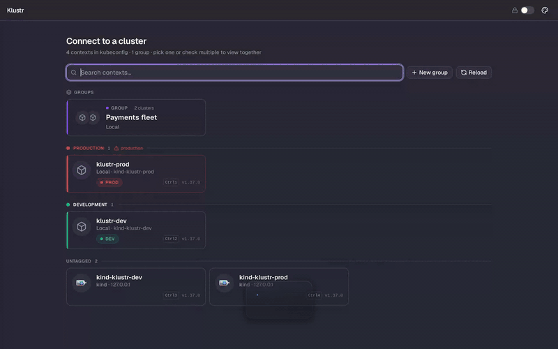
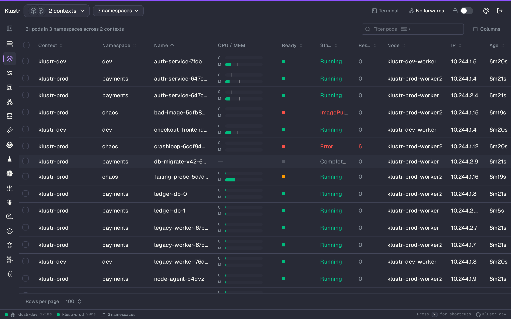
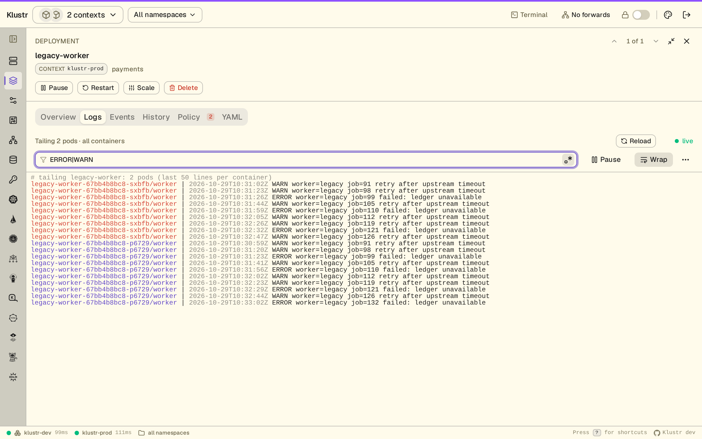
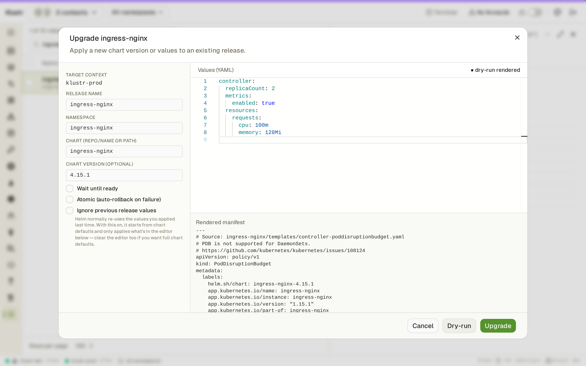
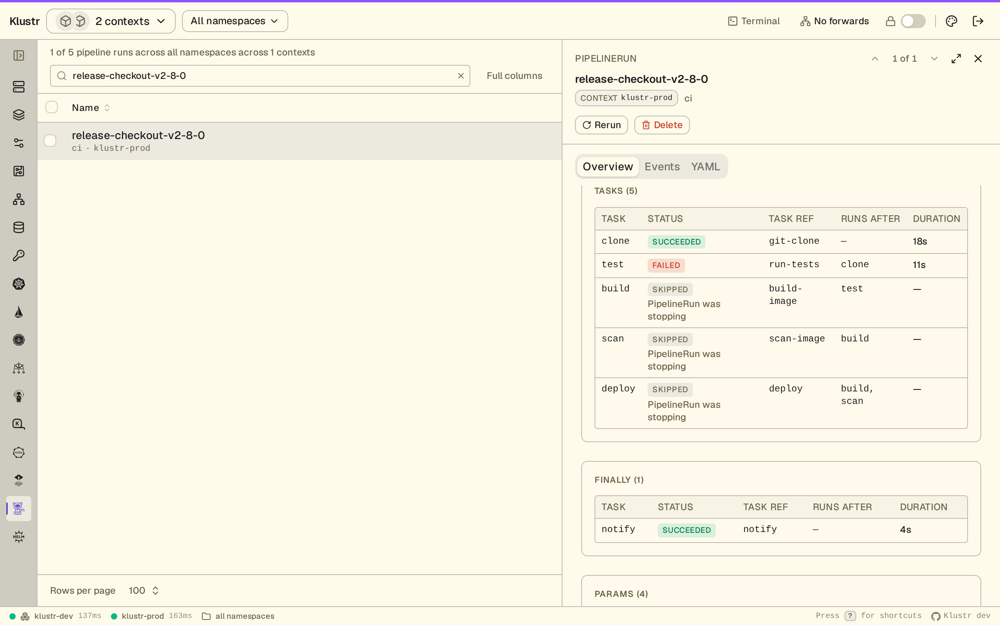

<p align="center">
  
</p>

<h1 align="center">Klustr</h1>

<p align="center">
  A native Kubernetes desktop client that installs <strong>nothing</strong> in your cluster.
</p>

<p align="center">
  <a href="LICENSE">
    
  </a>
  <a href="https://app.fossa.com/projects/git%2Bgithub.com%2FSametKUM%2Fklustr?ref=badge_shield">
    
  </a>
  
  <a href="https://github.com/SametKUM/klustr/releases/latest">
    
  </a>
  <a href="https://github.com/SametKUM/klustr/actions/workflows/release.yml">
    
  </a>
</p>

<p align="center">
  <strong>macOS</strong>&nbsp;·&nbsp;<code>brew tap sametkum/klustr && brew install klustr</code><br>
  <strong>Arch / CachyOS / Manjaro</strong>&nbsp;·&nbsp;<code>paru -S klustr-bin</code><br>
  <strong>Debian / Ubuntu</strong>&nbsp;·&nbsp;<code>sudo apt install ./klustr_*_amd64.deb</code> &nbsp;(<a href="#debian--ubuntu-deb">download first</a>)
</p>
<p align="center">
  <a href="#install">other install options</a>
</p>

<p align="center">
  <a href="https://github.com/SametKUM/klustr/blob/main/docs/hero.mp4">
    
  </a>
</p>
<p align="center">
  <sub><a href="https://github.com/SametKUM/klustr/blob/main/docs/hero.mp4">▶ Watch the full-quality video</a></sub>
</p>

## What is Klustr?

Klustr is a cross-platform Kubernetes desktop client for working across clusters. It reads your existing `~/.kube/config`, connects directly to the Kubernetes API and uses the permissions your contexts already have. Browse resources, troubleshoot workloads and manage ecosystem tools from one app, without the `argocd`, `flux`, `tkn` or `helm` CLI.

## Features

### Helm, GitOps and pipelines

- **Helm.** Install, upgrade, roll back and uninstall Helm v3 releases. Preview install and upgrade manifests with a dry-run diff, manage repositories and search charts — no `helm` CLI required.
- **Argo CD.** Sync, Refresh, Rollback and cascade-aware Delete through the Kubernetes API — no `argocd-server`, `argocd` CLI or Argo login.
- **Flux CD.** Kustomizations, HelmReleases, GitRepositories, HelmRepositories, OCIRepositories, Buckets, Providers, Alerts and Receivers, plus ImageRepositories, ImagePolicies and ImageUpdateAutomations. Inspect scanned tags, selected images and digests, and automation Git commits; follow repository references across namespaces. Reconcile and Suspend/Resume where the resource API supports them, without the `flux` CLI.
- **Managed by.** Follow a resource to its Argo CD Application, Flux Kustomization or HelmRelease, or Helm release — including Applications in another active context. YAML edit and Scale warn before changes the owner will revert, honoring Argo CD `ignoreDifferences`, Flux ignore rules and per-object opt-outs.
- **Tekton.** PipelineRuns, TaskRuns, Pipelines and Tasks. A task table joins the resolved pipeline with TaskRuns and skipped tasks; a graph shows dependency order, and step logs open on the running or failed step. Start a Pipeline from its params and workspaces, Cancel and Rerun without `tkn`. Triggers support includes EventListeners, Triggers, TriggerTemplates and (Cluster)TriggerBindings.

### Networking, policy and autoscaling

- **Gateway API.** Listener tables, per-rule match → backend → weight matrices and `RouteParentStatus` expose misrouted parents and `RefNotPermitted` backends. Vendor-neutral, with typed informers.
- **cert-manager.** Certificates, Issuers / ClusterIssuers and the full CertificateRequest → Order → Challenge chain, with readiness, expiry and links between resources. One-click Renew without `cmctl`.
- **Istio.** Gateways, VirtualServices, DestinationRules, ServiceEntries, Sidecars, AuthorizationPolicies, RequestAuthentications and PeerAuthentications. Follow hosts and destinations to Services, subsets to pods, and policies to workloads; reads use the discovered served API version.
- **Cilium.** Dedicated views for network policies, endpoints, nodes, identities, CIDR groups, LoadBalancer IP pools, L2 announcement and egress gateway policies, and BGP configuration. Inspect policy rules, IP allocation and reported BGP peer status, with links to referenced resources.
- **Karpenter.** NodePools, NodeClaims and AWS EC2NodeClasses with provisioning conditions, resolved subnets, security groups, AMIs, requirements and IAM configuration. Follow pools and claims to their node class; the Disruption tab on nodes and NodeClaims explains blockers such as `do-not-disrupt` pods, PDBs, active budgets and `consolidateAfter`.
- **KEDA.** ScaledObjects, ScaledJobs and (Cluster)TriggerAuthentications with triggers, Ready / Active / Fallback state and authentication references, without reading secret values. Pause at the current or a given replica count and Resume; KEDA-managed HPAs map `s0-…` metrics back to their triggers.
- **Kyverno.** ClusterPolicies, Policies, PolicyExceptions, every CEL policy kind (validating, image-validating, mutating, generating and deleting, with their namespaced variants) and `wgpolicyk8s.io` policy reports. Follow policy failures to resources and inspect each resource's own report in its Policy tab.

### Cluster management and access

- **Pure client.** Connect directly with your existing kubeconfig and permissions; no in-cluster agent required.
- **Live resource lists.** `client-go` informers keep resource lists current. Metrics and Events refresh periodically.
- **Multi-context aggregation.** View two or more clusters in one table, with per-context status and latency in the status bar.
- **Context groups and tags.** Save named context groups for one-click reconnect and use color tags to identify environments in the top bar.
- **Built-in resources.** Workloads, networking, storage, config, admission, autoscaling and the full RBAC set under a dedicated Access Control sidebar group.
- **Access Review.** A subject → effective-permissions GVR × verb matrix traces each permission through its binding and role. Wildcards and `cluster-admin` are flagged; reviews update live without `--as` impersonation or extra API traffic.
- **Custom resources.** CRDs are discovered on connect and grouped by API group. Resources without a dedicated integration get live lists with their printer columns and YAML details.
- **Cluster overviews.** CPU, memory and pod capacity, workload health and recent warnings for a single cluster or an aggregated session.

### Debugging and resource actions

- **Logs.** Stern-style streaming across pods with per-pod ANSI colors, follow, save, regex filtering, a line-count picker and previous container logs.
- **In-app exec.** Open a shell in a container over SPDY.
- **Node shell.** Open a root shell through a temporary privileged `nsenter` pod that is removed when the session ends — no SSH or preinstalled tooling.
- **Terminal.** A local shell drawer stays pinned to a context with `KUBECONFIG` set, alongside support for external terminal apps.
- **Cordon and drain.** Cordon/uncordon and a live-progress drain through the Eviction API, respecting PDBs and skipping DaemonSet and mirror pods.
- **YAML edit.** Monaco editor with a server-side dry-run diff before apply.
- **Scale, restart and pause/resume.** Replica controls, rolling restart, deployment pause/resume and inline HPA min/max editing.
- **In-place pod resize.** Change CPU and memory requests and limits through `pods/resize` without recreating the pod, with Deferred / Infeasible status displayed live.
- **Rollout history and rollback.** Compare revision templates side by side and revert Deployments, StatefulSets and DaemonSets.
- **Port-forwarding.** Suggested local ports, a persistent header indicator and click-to-open in the browser.

### Navigation and customization

- **Inspector.** Open details beside the live list without losing its filter or page. Resize the panel and step through results with `Alt+↑` / `Alt+↓`.
- **Cross-resource navigation.** Follow workload → pod → node links, inspect related resources and return through the back stack.
- **Themes and shortcuts.** Multiple light and dark themes, command palette (`⌘K`), pod search (`⌘P`), namespace search (`⌘N`) and a keyboard cheatsheet (`?`).

See the [documentation](#documentation) for integration guides and workflows.

## Install

### macOS (Apple Silicon)

The release build is signed with a Developer ID Application certificate and notarized by Apple, so Gatekeeper opens it directly — even offline.

#### Homebrew

```bash
brew tap sametkum/klustr
brew install klustr
```

After the initial `brew tap`, future updates are just `brew upgrade klustr` (or `brew upgrade` for everything), and `brew search klustr` / `brew info klustr` start finding it.

#### Manual

Download the latest darwin-arm64 tarball from the [Releases](https://github.com/SametKUM/klustr/releases/latest) page, then:

```bash
tar -xzf klustr-*-darwin-arm64.tar.gz
mv klustr.app /Applications/
open /Applications/klustr.app
```

### Linux (amd64)

The Linux binary links against `webkit2gtk-4.1` + `gtk-3`. Ubuntu 24.04+, Fedora 39+, Arch and most other modern distros ship those runtime libraries by default; on Ubuntu 22.04 install `libwebkit2gtk-4.1-0 libgtk-3-0` first.

#### Arch / CachyOS / Manjaro / Endeavour (AUR)

```bash
paru -S klustr-bin
# or
yay -S klustr-bin
```

The [`klustr-bin`](https://aur.archlinux.org/packages/klustr-bin) PKGBUILD uses the prebuilt release tarball, so install completes in seconds. `paru -Syu` keeps it up to date.

#### Debian / Ubuntu (.deb)

The .deb pulls in the runtime dependencies automatically and registers a `klustr` desktop entry.

```bash
VERSION="$(curl -fsSL https://api.github.com/repos/SametKUM/klustr/releases/latest | grep -oP '"tag_name":\s*"\K[^"]+')"
DEB="klustr_${VERSION#v}_amd64.deb"
curl -LO "https://github.com/SametKUM/klustr/releases/download/${VERSION}/${DEB}"
sudo apt install "./${DEB}"
```

#### Manual (tarball)

Download the latest `linux-amd64` tarball from the [Releases](https://github.com/SametKUM/klustr/releases/latest) page, then:

```bash
tar -xzf klustr-*-linux-amd64.tar.gz
install -Dm755 klustr ~/.local/bin/klustr
klustr
```

### Windows

Download the latest `windows-amd64` zip from the [Releases](https://github.com/SametKUM/klustr/releases/latest) page, extract it and run `klustr.exe`. Klustr is tested on Windows 11, which ships the WebView2 runtime it renders with.

The Windows build is not code-signed yet. On first launch SmartScreen shows "Windows protected your PC": choose **More info**, then **Run anyway**. With Smart App Control on, Windows blocks unsigned apps outright.

## Quick start

1. Klustr reads `~/.kube/config` at launch.
2. On first run, pick a context — or check **two or more** to view them aggregated as one cluster. Save a recurring selection as a named **group** for one-click reconnect, and toggle **Auto-connect** on a card to pin it as the default.
3. Browse via the sidebar, click any row to open it in the inspector beside the list, use `⌘K` to open the command palette, or `⌘P` to search pods by name. The header's **Disconnect** button drops you back to the picker at any time.

## Screenshots

Captured from two kind clusters with realistic workloads and deliberate failures. See the [full screenshot gallery](docs/screenshots/README.md) for more workflows and themes.

|   |   |
|---|---|
|  |  |
| **Multiple clusters** — pods from two clusters and three namespaces in one table | **Workload debugging** — one log stream across a Deployment, with pod colors and a live regex filter |
|  |  |
| **Helm upgrade** — review values and the dry-run manifest before applying | **Tekton** — inspect failed, skipped and completed pipeline tasks |

## Documentation

Task-focused guides live at [klustr.dev/docs](https://klustr.dev/docs/) (source: [SametKUM/klustr.dev](https://github.com/SametKUM/klustr.dev/tree/main/docs/guide)):

- [Getting started](https://klustr.dev/docs/getting-started/) — contexts, namespaces, read-only mode
- [Multi-context & aggregated mode](https://klustr.dev/docs/multi-context/) — many clusters as one, groups, tags
- [Credential helpers](https://klustr.dev/docs/credential-helpers/) — aws-vault and other exec plugins under a GUI launch
- [Cluster & workloads overviews](https://klustr.dev/docs/overview/) — capacity donuts, workload health, events feed
- [Workloads & debugging](https://klustr.dev/docs/workloads-and-debugging/) — logs, exec, port-forward, node shell
- [Terminal](https://klustr.dev/docs/terminal/) — the built-in shell drawer and external terminal apps
- [Helm](https://klustr.dev/docs/helm/) · [GitOps: Argo CD & Flux](https://klustr.dev/docs/gitops/) · [Tekton Pipelines](https://klustr.dev/docs/tekton/) · [Gateway API](https://klustr.dev/docs/gateway-api/) · [Kyverno & policy reports](https://klustr.dev/docs/kyverno/) · [Platform integrations](https://klustr.dev/docs/integrations/) · [Custom Resources](https://klustr.dev/docs/custom-resources/)

## Build from source

```bash
mise install          # installs Go, Node and the wails3 CLI pinned in .mise.toml
cd frontend && npm ci && cd ..
wails3 dev            # dev session: Vite hot reload, rebuilds on Go changes

# or a release build for your host platform, into build/bin
wails3 task build
```

On Linux the build needs the GTK3 / WebKit2GTK 4.1 development headers (`libgtk-3-dev libwebkit2gtk-4.1-dev` on Debian and Ubuntu).

## Architecture (short version)

| Layer | Choice |
|---|---|
| Desktop | Wails v3 (Go + native webview) |
| Backend | Go 1.27 + `client-go` (typed clientset + dynamic) + `sigs.k8s.io/gateway-api` |
| Frontend | React 19 · TypeScript · Vite |
| UI | Tailwind CSS · shadcn/ui |
| State | Zustand (real-time) · TanStack Query (mutations only) |
| Tables | TanStack Table |
| Live data | `client-go` informers → Wails events → Zustand → React |

Full design notes, conventions and the "add a new resource kind" recipe live in [`AGENTS.md`](AGENTS.md).

## Contributing

Bug reports and focused pull requests are welcome.

- Read [`AGENTS.md`](AGENTS.md) first — it's the architecture + conventions contract.
- Use [Conventional Commits](https://www.conventionalcommits.org/) (`feat:`, `fix:`, `refactor:` …) and prefer small, logically scoped commits.
- Before opening a PR, run:
  ```bash
  go test klustr/internal/... && go vet ./...
  cd frontend && npm test && npm run lint && npm run typecheck
  ```
- New user-facing features should include a screenshot or short clip in the PR description.

Full guide: [`CONTRIBUTING.md`](CONTRIBUTING.md). Bug reports go through the [`bug_report.yml`](.github/ISSUE_TEMPLATE/bug_report.yml) issue template so the version / OS / cluster details we need actually land in the report. Found a security issue? Please report it privately — see the [security policy](SECURITY.md).

## License

Klustr is licensed under the [Apache License 2.0](LICENSE). The screenshots, demo video and other documentation under [`docs/`](docs) are licensed under [CC BY 4.0](docs/LICENSE).

## Acknowledgments

Built on the shoulders of: [Wails](https://wails.io/), [client-go](https://github.com/kubernetes/client-go), [React](https://react.dev/), [shadcn/ui](https://ui.shadcn.com/), [Tailwind CSS](https://tailwindcss.com/), [TanStack Table / Query](https://tanstack.com/), [xterm.js](https://xtermjs.org/), [Monaco Editor](https://microsoft.github.io/monaco-editor/), [Zustand](https://zustand-demo.pmnd.rs/), [Vite](https://vitejs.dev/), [mise](https://mise.jdx.dev/).
